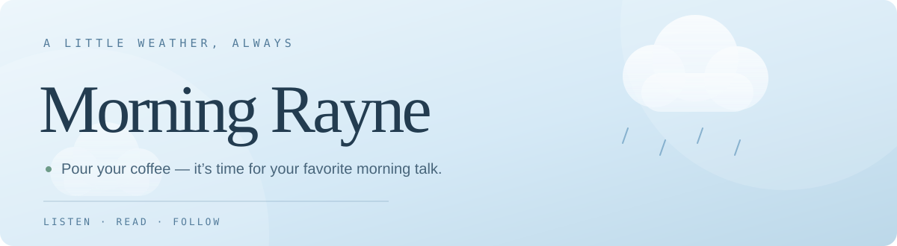

<div align="center">

<a href="https://pauzedevs.github.io/raynepodcastwebsite/">
  
</a>

[](https://github.com/PauzeDevs/raynepodcastwebsite/actions/workflows/site-status.yml)
[](https://pauzedevs.github.io/raynepodcastwebsite/)
[](https://github.com/PauzeDevs/raynepodcastwebsite)

*Pour your coffee — it’s time for Morning Rayne, your favorite morning talk.*

</div>

---

## About

A soft, weather-inspired home for **Morning Rayne**. The site brings the podcast, writing and social links together in one responsive experience.

### Explore

| Page | What you'll find |
|---|---|
| [Home](https://pauzedevs.github.io/raynepodcastwebsite/) | The show, animated weather moods and paths into the site |
| [Podcast](https://pauzedevs.github.io/raynepodcastwebsite/podcast.html) | The embedded Spotify show player and listening platforms |
| [Letters](https://pauzedevs.github.io/raynepodcastwebsite/letters.html) | Morning Rayne's Substack publication |
| [Elsewhere](https://pauzedevs.github.io/raynepodcastwebsite/elsewhere.html) | Instagram, YouTube, TikTok, Spotify and Substack |

## Website health

The **Website status** badge above is powered by GitHub Actions. The workflow checks that the live homepage and key pages respond successfully, and runs on pushes to `main`, on a schedule every six hours, or when manually triggered.

- **Green badge:** the latest workflow run passed.
- **Red badge:** the latest run failed; open the badge to inspect the logs.
- **No status yet:** open the workflow and select **Run workflow**, or wait for its first run.

> The badge reports the last automated availability check. It does not guarantee every external embed or feature is working in every browser.

## Tech and accessibility

- Static HTML, CSS and JavaScript hosted with GitHub Pages
- Responsive layouts for phones, tablets and desktop screens
- Reduced-motion support for users who prefer less animation
- Sitemap, robots.txt, page metadata and a custom 404 page
- Lightweight client-side interactions; no app backend required

## Local preview

Because this is a static site, open `index.html` in a browser for a quick preview. For a local HTTP server, run:

```bash
python3 -m http.server 8000
```

Then visit [http://localhost:8000](http://localhost:8000).

## Links

- **Live site:** https://pauzedevs.github.io/raynepodcastwebsite/
- **Source code:** https://github.com/PauzeDevs/raynepodcastwebsite
- **Developer:** [PauzeDevs](https://github.com/PauzeDevs)

---

<div align="center">

Made with care for Morning Rayne · Website by [PauzeDevs](https://github.com/PauzeDevs)

</div>
